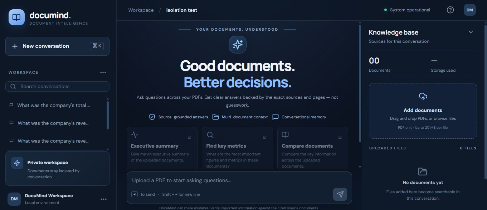
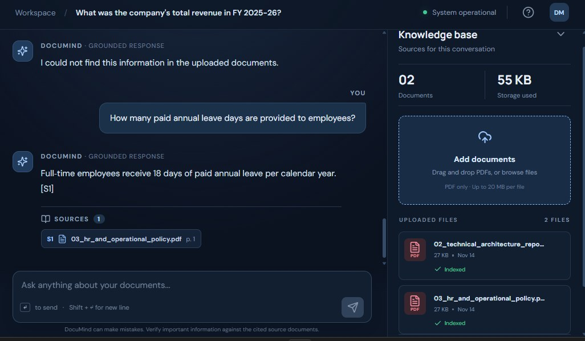
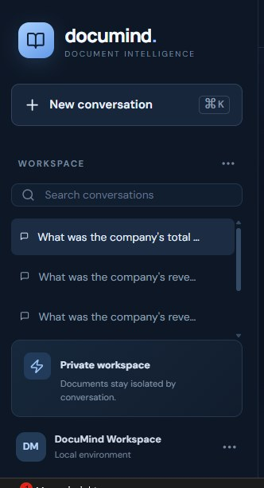
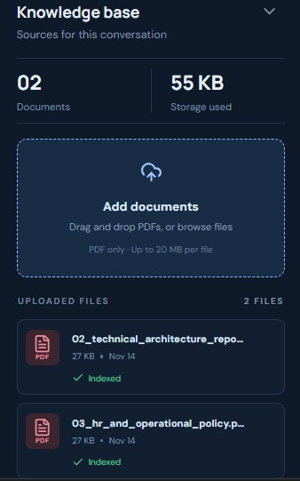
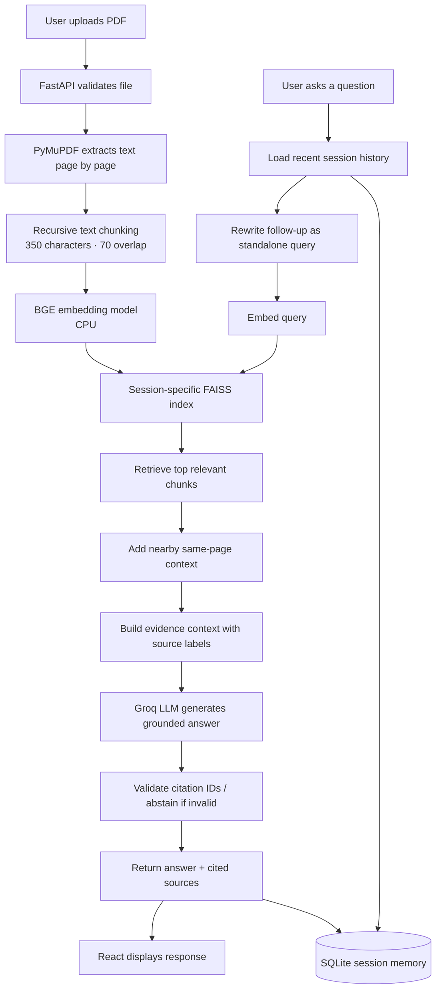

<div align="center">

# DocuMind

### Multi-Document RAG with Conversational Memory

**Ask questions across your PDFs. Get evidence-grounded answers with document and page references.**

[](https://github.com/sachinchoudharyy/DocuMind)


</div>

---

## Overview

DocuMind is a full-stack **Retrieval-Augmented Generation (RAG)** application that lets users upload multiple PDF documents into a conversation and ask questions in natural language.

Instead of asking an LLM to answer from its general knowledge, DocuMind first retrieves relevant passages from the uploaded documents, then uses those passages as the evidence for answer generation. Responses include source references so users can inspect where information came from.

**Key capabilities**
- Multi-PDF upload and document-level text extraction.
- Semantic retrieval using BGE embeddings and FAISS.
- Answers grounded in retrieved document passages with source/page references.
- Follow-up question resolution using recent conversation history.
- Separate document storage and FAISS indexes for each conversation.
- Abstention when relevant evidence is unavailable or a valid citation cannot be produced.

## Application Preview

### Workspace



### Grounded answer with source reference



### Conversation history and document library

| Conversation sidebar | Knowledge base |
|---|---|
|  |  |

## How It Works



### 1. Document ingestion

1. The user uploads PDF files to a conversation.
2. FastAPI validates the file type, PDF signature, readability and configured size limit.
3. PyMuPDF extracts text page by page while retaining the source filename and page number.
4. `RecursiveCharacterTextSplitter` divides the text into focused chunks using a configured size of **350 characters** and **70 characters overlap**.
5. `BAAI/bge-small-en-v1.5` converts each chunk into a normalized vector.
6. FAISS stores the vectors in the index belonging to that conversation.

**Why this approach?** Smaller overlapping chunks make retrieval more focused while preserving some context across chunk boundaries. Page metadata allows retrieved evidence to be traced back to the original PDF.

### 2. Question answering

1. The backend receives the question and loads recent messages from the same conversation.
2. If the message is a follow-up, the LLM rewrites it as a standalone search question while preserving its subject and metric.
3. The query is embedded with the same BGE model and searched against the active conversation's FAISS index.
4. The retriever selects the top matching chunks and can include adjacent chunks from the same source page for additional context.
5. The RAG chain labels the evidence (for example, `[S1]`) and sends the resolved question plus retrieved passages to the Groq model.
6. The answer prompt instructs the model to use retrieved passages as its factual evidence and to state when the documents do not contain the answer.
7. Citation labels are normalized and checked against the sources supplied to the model. Unsupported source IDs are removed; an answer without a valid citation is not returned as a grounded answer.
8. The answer and source metadata are saved with the conversation and displayed in the React UI.

**Why separate rewriting, retrieval and generation?** Conversation history helps interpret what the user means; retrieved PDF passages provide the factual evidence. Keeping these responsibilities separate helps reduce answers based on unrelated chat history.

## Reliability & Retrieval Design

| Design choice | Purpose |
|---|---|
| BGE semantic embeddings | Retrieve passages with related meaning even when the question uses different wording. |
| 350 / 70 chunking | Balance focused passages with continuity across chunk boundaries. |
| Top-k retrieval | Limit the initial evidence set to the most relevant matches. |
| Same-page neighbor context | Restore nearby context without combining unrelated documents or pages. |
| Follow-up rewriting | Resolve references such as “the previous year” before retrieval. |
| Evidence-only answer prompt | Keep answer generation focused on retrieved document content. |
| Citation ID validation | Prevent unknown source labels from being presented as valid citations. |
| Abstention behavior | Avoid presenting unsupported answers as facts. |
| Per-session FAISS index | Keep each conversation's document search isolated. |
| Shared embedding instance | Avoid repeatedly initializing the same embedding model within the backend process. |

> **Accuracy note:** These are reliability and retrieval safeguards, not a measured accuracy percentage. No benchmark score is claimed. A quantitative accuracy claim would require a labelled evaluation dataset and metrics such as Recall@K, MRR/nDCG, answer correctness and citation precision.

## Technology Stack

| Layer | Technologies |
|---|---|
| Frontend | React, TypeScript, Vite |
| Backend API | Python, FastAPI |
| PDF processing | PyMuPDF |
| Chunking / orchestration | LangChain |
| Embeddings | `BAAI/bge-small-en-v1.5` |
| Vector search | FAISS |
| LLM | Groq — `openai/gpt-oss-20b` |
| Conversation persistence | SQLite |

**Why FAISS?** It provides local vector similarity search without requiring a separately managed hosted vector database for this assessment prototype.

## Run Locally

### Prerequisites

- Python 3.11+ (or the Python version validated with the project)
- Node.js and npm
- Groq API key
- Internet access for the first embedding-model download and Groq requests

### 1. Clone the repository

```bash
git clone https://github.com/sachinchoudharyy/DocuMind.git
cd DocuMind
```

### 2. Set up the backend

```powershell
cd backend
python -m venv .venv
.\.venv\Scripts\Activate.ps1
pip install -r requirements.txt
```

Create `backend/.env` using `backend/.env.example` and set your key:

```env
GROQ_API_KEY=your_groq_api_key
GROQ_MODEL=openai/gpt-oss-20b
EMBEDDING_MODEL=BAAI/bge-small-en-v1.5
EMBEDDING_DEVICE=cpu
```

Start the API from the `backend` directory:

```powershell
uvicorn app.api.main:app --reload --host 127.0.0.1 --port 8000
```

API documentation: [http://127.0.0.1:8000/docs](http://127.0.0.1:8000/docs)

### 3. Set up the frontend

Open another terminal from the repository root:

```powershell
cd frontend
npm install
npm run dev
```

Open [http://localhost:5173](http://localhost:5173).

> Keep `.env` private. Never commit API keys, local databases, uploaded private PDFs, FAISS indexes, virtual environments or `node_modules`.

## Testing

Run from `backend` with the virtual environment activated:

```powershell
python -m unittest tests.test_embedding_model -v
python -m unittest tests.test_rag_quality -v
python -m tests.test_rag
python -m tests.test_memory
python -m tests.test_document_isolation
```

The tests and manual verification reported during development cover:
- embedding model instance reuse;
- empty-retrieval abstention and citation validation;
- follow-up question rewriting;
- RAG answers with source references;
- session-specific document retrieval;
- document deletion and index rebuild;
- frontend/backend startup and PDF upload workflow.

The developer reported **1 embedding reuse test and 4 RAG-quality tests passing**, plus successful RAG, memory and document-isolation integration checks. These are local development results, not a third-party audit or production load/security certification.

## Project Structure

```text
DocuMind/
├── backend/
│   ├── app/
│   │   ├── api/
│   │   ├── chains/
│   │   ├── embeddings/
│   │   ├── ingestion/
│   │   ├── memory/
│   │   ├── retrieval/
│   │   ├── services/
│   │   └── vectorstore/
│   ├── data/
│   │   └── sample_documents/
│   └── tests/
├── frontend/
│   └── src/
├── docs/
│   └── screenshots/
└── README.md
```

Runtime uploads, SQLite data and generated FAISS indexes are stored locally and should not be committed.

## Limitations & Future Improvements

- OCR support for scanned/image-only PDFs.
- A labelled evaluation benchmark for retrieval, answer quality and citation accuracy.
- Optional reranking for difficult retrieval queries.
- Stronger semantic citation-entailment checks.
- Authentication, authorization and tenant-level access control.
- Background jobs, rate limits, observability and production deployment hardening.

DocuMind is an assessment-focused local prototype; it is not presented as a production-hardened multi-tenant service.

## Author

**Sachin Choudhary**  
AI/ML Engineer

- GitHub: [@sachinchoudharyy](https://github.com/sachinchoudharyy)
- Project: [DocuMind](https://github.com/sachinchoudharyy/DocuMind)

---

<div align="center">

**Built with Python, FastAPI, React, FAISS and Generative AI.**

</div>
