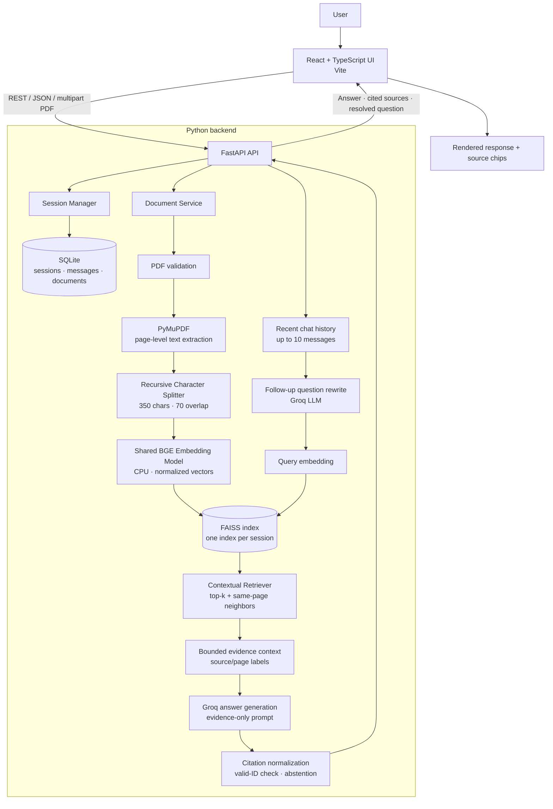
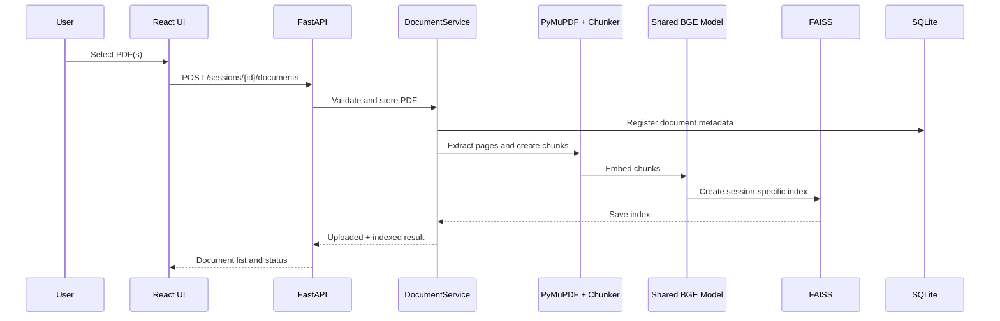
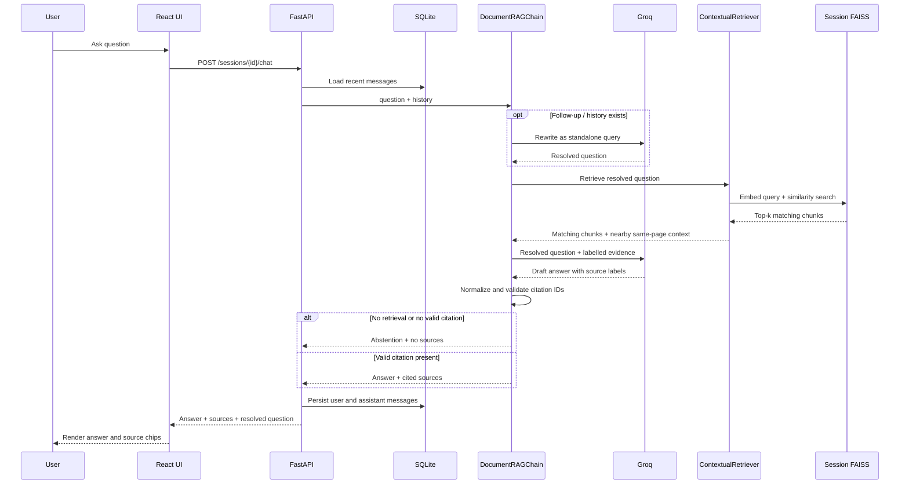

# DocuMind Architecture

## System architecture



## Upload / indexing sequence



## Question / answer sequence



## Trust boundaries and data ownership

- A conversation owns its document records, uploaded files and FAISS index.
- The SQLite database stores session metadata, messages, citation metadata and document records.
- The embedding model runs in the backend process and is reused within that process.
- The Groq API is an external model service. The application sends the resolved question and retrieved context for generation.
- The UI does not query FAISS or SQLite directly; it uses the FastAPI endpoints.

## Runtime storage layout

```text
backend/data/
├── chat_history.db
├── uploads/
│   └── <session_id>/
│       └── <generated_id>_<original_filename>.pdf
└── vectorstore/
    └── <session_id>/
        ├── index.faiss
        └── index.pkl
```

Actual runtime contents are generated locally and should not be committed to Git.
